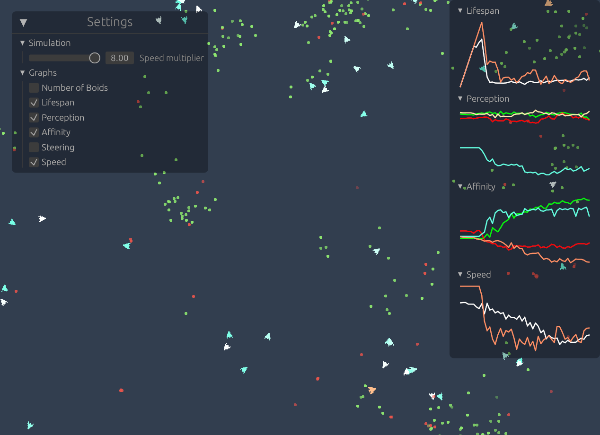

# Procedural World Generation

[](https://github.com/partrita/rust-ecosystem-simulation/actions/workflows/build.yml)

This is a simple boid ecosystem simulation inspired by Daniel Shiffman's (TheCodingTrain) Ecosystem simulation - https://www.youtube.com/watch?v=flxOkx0yLrY

Built in [Rust](https://www.rust-lang.org/) using the [Bevy](https://bevyengine.org/) game engine.



## Usage
- Clone the repo
```bash
git clone git@github.com:partrita/rust-ecosystem-simulation.git
cd rust-ecosystem-simulation
```
- Run the simulation
```bash
cargo run
```

## Automated Builds
This project uses GitHub Actions to automatically build binaries for Linux, Windows, and macOS. 
You can find and download the latest builds from the [Actions tab](https://github.com/partrita/rust-ecosystem-simulation/actions) under the "Rust Build" workflow.

## Controls
- `Backspace` - Show graphs
- `Tilde` - Show settings (Graphs, Simulation Speed)
- `Tab` - Show debug gizmos
- `1` - Camera follow boid
- `2` - Camera follow predator boid
- `3` - Camera snap to center

## Configurations
- The project config file is located at `src/configs.rs`
